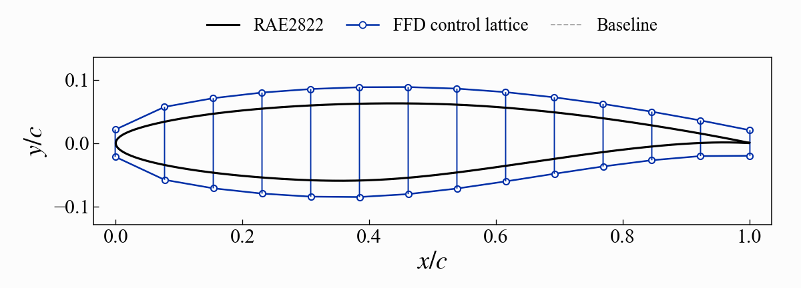
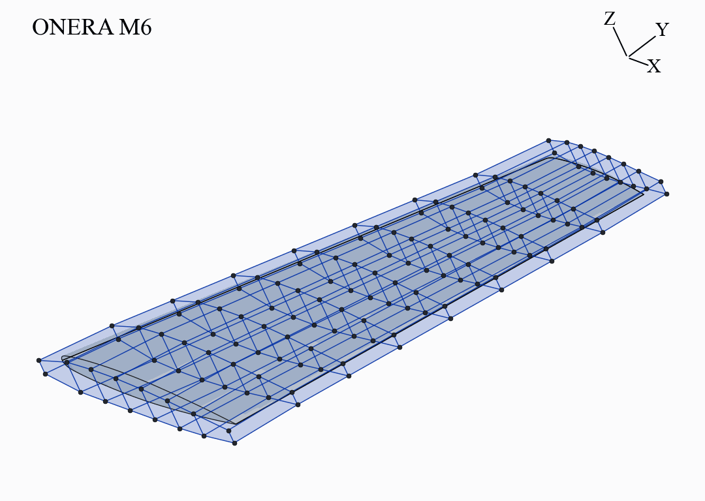
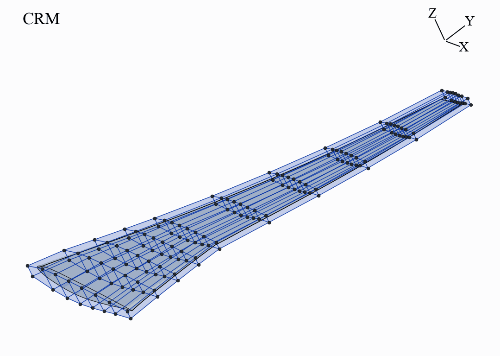

# SU2 贴体 FFD 控制格生成工具

面向 **SU2** 的独立贴体自由变形（Free-Form Deformation，FFD）控制格生成工具。根据二维翼型坐标或三维机翼表面，生成随外形分布的控制格，并将控制点及翼面参数坐标写入 SU2 网格，用于后续的形状参数化与网格变形。

控制格生成基于 MDOLab **pyGeo**，翼面嵌入采用与 SU2 `BSPLINE_UNIFORM` 对应的开放均匀 B 样条。生成阶段可以独立运行；连接已有计算网格后，由 **`SU2_DEF`** 完成翼面和体网格变形。

## 变形展示

以下动图展示控制点位移与几何外形之间的映射关系。蓝色表示 FFD 控制格；机翼内部保留几何轮廓线。动图使用与 SU2 对应的 B 样条规则计算表面变形，位移仅用于演示。

### RAE2822：二维翼型



### ONERA M6：三维机翼



### CRM：三维机翼



另提供 [NACA0012 独立示例](demo/NACA0012/)及其[变形动图](demo/NACA0012/ffd_deformation.gif)。

## 主要功能

- **二维翼型**：由上、下表面坐标生成贴体控制格，支持尖后缘和有限厚度后缘。
- **三维机翼**：由表面三角形和前、后缘参考线生成控制格，可设置弦向与展向控制点数量及包络余量。
- **控制格读写与嵌入**：支持单控制体 ASCII PLOT3D 文件，计算表面点的参数坐标并检查重构误差。
- **SU2 导出**：保留已有计算网格，在输出 `.su2` 文件中写入原生 FFD 数据，供 `SU2_DEF` 使用。

## 依赖与安装

推荐使用 Linux 或 WSL2 环境。

| 功能 | 依赖 |
| --- | --- |
| 控制格读写、参数映射及 SU2 导出 | NumPy、SciPy |
| 贴体控制格生成 | MDOLab pyGeo、pySpline、mdolab-baseclasses、mpi4py |
| 示例绘图与 GIF 生成 | Matplotlib、Pillow |
| 实际计算网格变形 | SU2，包含 `SU2_DEF` |

pyGeo 与 pySpline 请按 [MDOLab 官方安装说明](https://mdolab-pygeo.readthedocs-hosted.com/en/latest/install.html)安装；pySpline 需要编译。其余 Python 依赖可在所用环境中安装：

```bash
python -m pip install numpy scipy matplotlib pillow
```

克隆仓库时将本地目录命名为 `FFD`：

```bash
git clone https://github.com/bominwang/SU2-FFD.git FFD
```

本工具可作为名为 `FFD` 的包目录放入任意 Python 项目，目录结构如下：

```text
project/
├── FFD/
│   ├── __init__.py
│   ├── lattice.py
│   ├── pygeo_adapter.py
│   ├── su2.py
│   ├── README.md
│   └── demo/
└── your_script.py
```

从项目目录运行时，使用 `from FFD import ...` 导入。如果沿用 `Engineering/FFD` 的目录布局，也可使用 `from Engineering.FFD import ...`。示例脚本会自动定位上级包，可直接运行。

## 快速开始

### 1. 生成二维翼型控制格

准备 `lower.txt` 和 `upper.txt`，每行保存一个 `x y` 坐标点。两侧均按前缘到后缘排列，x 严格递增，弦向起止位置相同，使用一致的长度单位。

```python
import numpy as np
from FFD import ControlLattice, generate_airfoil_plot3d

# 以下余量对应单位弦长坐标。
generate_airfoil_plot3d(
    np.loadtxt("lower.txt"),
    np.loadtxt("upper.txt"),
    "airfoil_ffd.xyz",
    n_chord=14,
    x_margin=0.001,
    thickness_margin=0.02,
    relative_thickness_margin=0.05,
)

lattice = ControlLattice.from_plot3d(
    "airfoil_ffd.xyz",
    orders=(4, 2, 2),
    tag="AIRFOIL_FFD",
)
```

输出控制格为 `14 × 2 × 2`：弦向 14 列、上下两排，以及 `z = ±0.5` 的两个虚拟层。两个虚拟层的 xy 坐标相同，符合 SU2 二维 FFD 的存储方式。

`x_margin` 和 `thickness_margin` 是绝对长度余量；`relative_thickness_margin` 是相对局部厚度的单侧余量。这些参数定义控制格包络，控制点的可移动范围另行设置。

### 2. 生成三维机翼控制格

准备翼面三角形 `wing_triangles.npy`，形状为 `(N, 3, 3)`，以及前、后缘参考线文件，每行保存一个 `x y z` 坐标点。以下采用 x 为弦向、y 为展向、z 为升力方向。

```python
import numpy as np
from FFD import ControlLattice, generate_wing_plot3d

generate_wing_plot3d(
    np.load("wing_triangles.npy"),
    "wing_ffd.xyz",
    surface_format="point-point",
    leading_edge=np.loadtxt("leading_edge.txt"),
    trailing_edge=np.loadtxt("trailing_edge.txt"),
    n_span=9,
    n_chord=8,
    absolute_margins=[0.01, 0.001, 0.01],
    relative_margins=[0.01, 0.001, 0.05],
    lift_index=3,
)

lattice = ControlLattice.from_plot3d(
    "wing_ffd.xyz",
    orders=(4, 2, 2),
    tag="WING_FFD",
)
```

`lift_index=3` 对应 z 方向升力，控制格排列为 `(n_chord, n_span, 2)`；`lift_index=2` 对应 y 方向升力，排列为 `(n_chord, 2, n_span)`。两类余量均按**弦向、展向、厚度**排列。`n_span` 也可传入列表，分别指定参考线各段的控制截面数量。

生成过程沿参考线投影寻找上下表面，无需逐一提供翼型截面。参考线需位于可投影的翼面范围内；当前接口生成单控制体，适用于能够由该控制体覆盖的翼型与机翼表面。

### 3. 导出至 SU2 并执行变形

将控制格与已有 `.su2` 计算网格连接：

```python
from FFD import export_su2

report = export_su2(
    "airfoil.su2",
    "airfoil_with_ffd.su2",
    lattice,
    markers=("AIRFOIL",),
)
print(report["su2_config_options"])
```

`markers` 必须使用输入网格中的实际翼面边界名称。输出网格保留原节点、单元及边界，并写入控制点、FFD 属性和翼面参数坐标。

在算例的 `SU2_DEF` 配置中填写返回的 `FFD_BLENDING`、`FFD_BSPLINE_ORDER`、`FFD_DEGREE` 等选项，并指定输入输出网格、活动控制点、固定控制面、位移方向及位移量，然后运行：

```bash
SU2_DEF deform.cfg
```

每个新设计从同一份已嵌入 FFD 的基准网格开始施加位移。`SU2_DEF` 完成表面映射及体网格变形，变形后的网格可继续交给 SU2 求解器。

`orders` 表示样条阶数，即多项式次数加一，例如 4 对应三次 B 样条；SU2 的 `FFD_DEGREE` 字段则记录控制点数量减一。已有 FFD 数据会在导出文件中替换；输出文件默认禁止覆盖，需要时显式设置 `overwrite=True`。

## 运行示例

四个示例均包含独立几何输入、生成脚本、控制格和可视化结果。以下命令在本工具根目录执行：

```bash
python -B demo/NACA0012/generate_ffd.py
python -B demo/RAE2822/generate_ffd.py
python -B demo/M6/generate_ffd.py
python -B demo/CRM/generate_ffd.py
```

| 示例 | 几何输入 | 控制点布局 |
| --- | --- | --- |
| [NACA0012](demo/NACA0012/) | MACH-Aero 官方教程的钝后缘翼型坐标 | 10 × 2 × 2 |
| [RAE2822](demo/RAE2822/) | 有限厚度后缘的上下表面坐标 | 14 × 2 × 2 |
| [ONERA M6](demo/M6/) | MACH-Aero 官方 IGES 几何 | 8 × 9 × 2 |
| [CRM](demo/CRM/) | NASA CRM IGES 中的机翼曲面 | 8 × 10 × 2 |

每个生成脚本更新对应目录的 `ffd.xyz`、`ffd.png`、`ffd.svg` 和 `validation.json`。M6、CRM 可添加 `--plot-only` 重绘已有控制格。

使用公用脚本重新生成动图：

```bash
# 生成全部四个示例。
python -B demo/animate_ffd.py

# 只生成选定示例。
python -B demo/animate_ffd.py --cases RAE2822 M6 CRM
```

默认输出 96 帧、20 帧/秒的循环 GIF，可通过 `--frames`、`--fps`、`--dpi` 调整。脚本固定基准几何的参数坐标，逐帧计算控制点位移对应的表面形状，在各示例目录保存 `ffd_deformation.gif` 及 `animation.json`。校验记录包含重构误差、采样 Jacobian、输入来源与文件校验值。

## 文件与接口

| 文件 | 作用 |
| --- | --- |
| [`pygeo_adapter.py`](pygeo_adapter.py) | 将二维翼型或三维机翼输入转换为 pyGeo 贴体控制格 |
| [`lattice.py`](lattice.py) | PLOT3D 读写、B 样条映射、参数嵌入与 Jacobian 计算 |
| [`su2.py`](su2.py) | 读取 SU2 边界，导出原生 FFD 数据 |
| [`demo/animate_ffd.py`](demo/animate_ffd.py) | 四个示例共用的几何变形动图脚本 |

| 接口 | 用途 |
| --- | --- |
| `generate_airfoil_plot3d(...)` | 生成二维翼型贴体控制格 |
| `generate_wing_plot3d(...)` | 生成三维机翼贴体控制格 |
| `ControlLattice.from_plot3d(...)` | 读取单控制体 ASCII PLOT3D 文件 |
| `ControlLattice.embed(xyz)` | 求解参数坐标并检查几何重构误差 |
| `ControlLattice.evaluate(uvw)` | 计算参数坐标对应的物理位置 |
| `ControlLattice.jacobian(uvw)` | 计算映射 Jacobian |
| `export_su2(...)` | 为已有 SU2 网格写入 FFD 数据 |
| `read_surface(...)` | 读取 SU2 节点和边界节点编号 |

`.xyz` 保存 FFD 控制点；`.su2` 保存计算网格及追加的 FFD 数据。当前网格接口支持单区域、串行 ASCII SU2 网格，以及线段、三角形和四边形边界。控制格生成与导出会检查基准嵌入；实际设计中的厚度、固定边缘及变形后单元质量由算例流程校核。

## 依赖项目与示例来源

- [SU2](https://github.com/su2code/SU2)：原生 FFD 定义与实际网格变形。
- [MDOLab pyGeo](https://github.com/mdolab/pygeo)：贴体控制格生成，使用 [`createFittedWingFFD`](https://mdolab-pygeo.readthedocs-hosted.com/en/latest/geo_utils.html#pygeo.geo_utils.ffd_generation.createFittedWingFFD)。
- [MDOLab pySpline](https://github.com/mdolab/pyspline)：pyGeo 所需的样条计算库。
- [MACH-Aero](https://github.com/mdolab/MACH-Aero/tree/075d1b64da4a65fb25b0bc54f6041884343aff0c/tutorial)：NACA0012 坐标及 ONERA M6 几何来源。
- [NASA Common Research Model](https://commonresearchmodel.larc.nasa.gov/geometry/iges-files/)：CRM 几何来源。

M6 和 CRM 的原始来源及 SHA256 保存在各示例的 `source.json`；二维几何的来源与校验信息保存在对应 `validation.json`。
